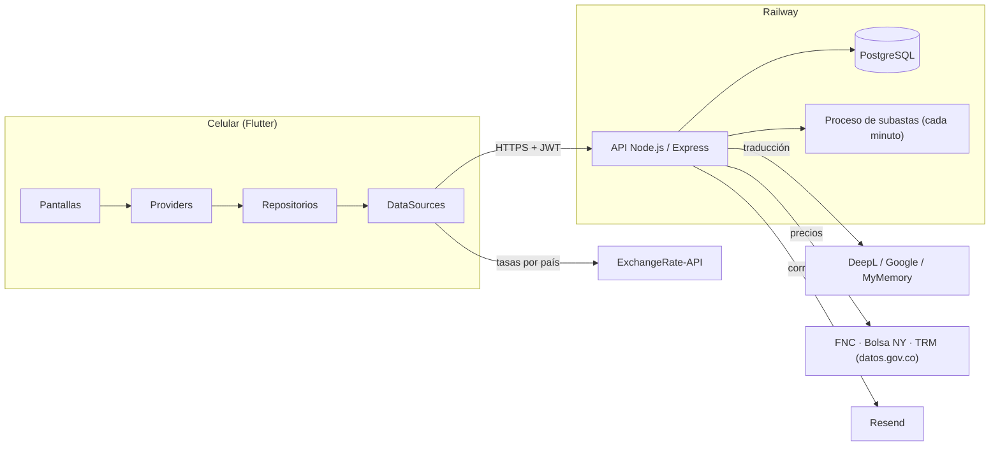
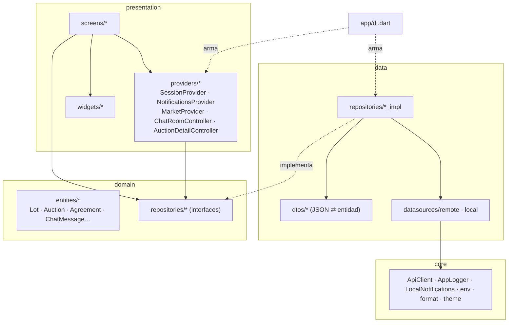
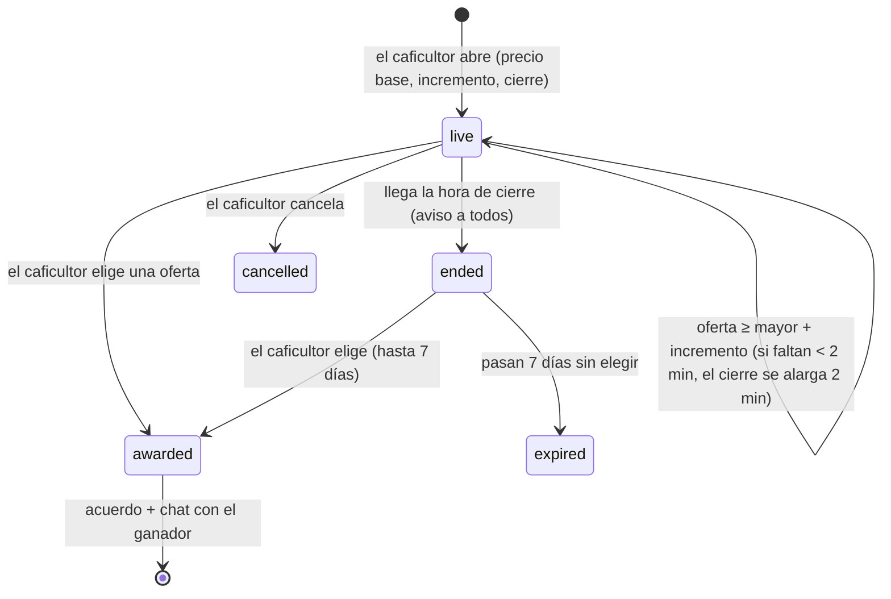

# Arquitectura de CaféDirecto

## Vista general



- **App:** Flutter (Android y web). Habla solo con la API.
- **API:** Node.js 20 + Express 4, desplegada en Railway desde la rama `gustavo` (carpeta `server/`).
- **Base de datos:** PostgreSQL 16 en Railway. El esquema se crea y actualiza solo al arrancar (`server/src/schema.sql`).
- **Tiempo real:** la app consulta cada pocos segundos (chat 3 s, contadores 10 s; 30 s en segundo plano).

## App Flutter: capas



| Capa | Carpeta | Responsabilidad | Ejemplo |
| --- | --- | --- | --- |
| Núcleo | `lib/core` | Infraestructura común sin reglas de negocio | `ApiClient` agrega el token, mide el tiempo y traduce errores a `ApiException` |
| Dominio | `lib/domain` | Entidades puras y contratos | `abstract class AuctionRepository { Future<Auction> bid(...) }` |
| Datos | `lib/data` | Cómo se obtienen los datos | `AuctionDto.fromJson(json).toEntity()` |
| Presentación | `lib/presentation` | Estado (Provider) y pantallas | `AuctionDetailController` consulta cada 5 s y expone `bid()`, `award()` |
| Aplicación | `lib/app` | Inyección de dependencias y rutas | `AppDependencies.create()` |

**Regla de dependencia:** `presentation → domain ← data → core`. Las pantallas no importan nada de `data/`.
Gracias a eso, `test/providers_test.dart` prueba los providers con repositorios falsos, sin servidor.

### Estado (Provider)

| Provider | Alcance | Qué guarda |
| --- | --- | --- |
| `SessionProvider` | Toda la app | Usuario, perfil, idioma, pestaña, avisos breves (toasts) |
| `NotificationsProvider` | Toda la app | Mensajes y avisos sin leer, lista de la campanita, avisos del teléfono |
| `MarketProvider` | Toda la app | Precios del café y tasas de cambio (caché 5 min) |
| `ChatRoomController` | Una conversación | Mensajes, acuerdos, envío optimista, consulta cada 3 s |
| `AuctionDetailController` | Una subasta | Ofertas en vivo (cada 5 s), pujar, adjudicar, cancelar |

Atajos: `context.app` (sesión, se redibuja), `context.session` (sesión en callbacks), `context.repo<T>()` (repositorio).

### Seguridad en el teléfono

- El token JWT se guarda **cifrado** (Android Keystore) con `flutter_secure_storage`; se desactivan las copias de seguridad.
- Si el servidor responde 401, `ApiClient.onUnauthorized` cierra la sesión.
- Los errores no capturados se registran (`FlutterError.onError`, `PlatformDispatcher.onError`).

## Servidor: capas

```
server/src
├─ index.js        arranque, apagado ordenado (SIGTERM)
├─ app.js          Express: cabeceras de seguridad, registro, CORS, rutas, errores
├─ routes/         HTTP: validan la entrada y responden
├─ services/       reglas de negocio compartidas (acuerdos, subastas, avisos, mercado, fotos)
├─ serialize.js    filas → JSON que consume la app (DTO de salida)
├─ lib/            http (errores, validación, transacciones), media (firma de fotos), secrets, middleware, privacy
├─ db.js           pool de PostgreSQL y migración
└─ auth.js · translate.js · mail.js · ratelimit.js
```

### Flujos principales

**Negociación 1 a 1 (chat):** cotización → contraoferta(s) → una parte acepta → la otra confirma → `createAgreement`
(bloquea el lote con `FOR UPDATE`, descuenta sacos, genera el código `CD-AAAA-####`).

**Subasta:**



**Estados del acuerdo:** 1 confirmado → 2 enviado (**lo marca el caficultor**) → 3 entregado (**lo marca el comprador**) → calificaciones.

**Interés en un lote:** cuando un comprador abre un lote se registra en `lot_views` y el caficultor recibe un aviso
(máximo uno por comprador y lote cada 24 h).

**Precios del café:** el servidor lee el precio interno de la FNC, el contrato C de Nueva York y la TRM oficial,
los guarda en caché 20 min y registra un valor diario en `market_snapshots` para el histórico. Si una fuente falla
usa el último valor bueno, y si no hay precio de la FNC lo estima con bolsa + TRM + prima (marcado "Estimado").

### Seguridad del servidor

| Tema | Cómo se resuelve |
| --- | --- |
| Contraseñas | bcrypt (costo 10); 8+ caracteres con letras y números; comparación en tiempo constante |
| Sesiones | JWT HS256 de 90 días con `token_version` (cambiar la contraseña cierra las demás sesiones) |
| Fuerza bruta | Límites por IP y usuario: login, registro, recuperación, mensajes, fotos, ofertas, traducción |
| Fotos | Dirección firmada con HMAC (`/images/ID?s=FIRMA`), tipo real por sus bytes, solo fotos propias |
| Entrada | Validación de tipos y rangos en cada ruta; consultas con parámetros (sin inyección SQL) |
| Datos | Restricciones `CHECK`, llaves foráneas e índices; transacciones con bloqueo en acuerdos y subastas |
| Cabeceras | `nosniff`, `X-Frame-Options`, HSTS, sin `X-Powered-By`, CORS configurable |
| Operación | Registro por petición con `X-Request-Id`, errores 500 sin detalles al cliente, apagado ordenado |
